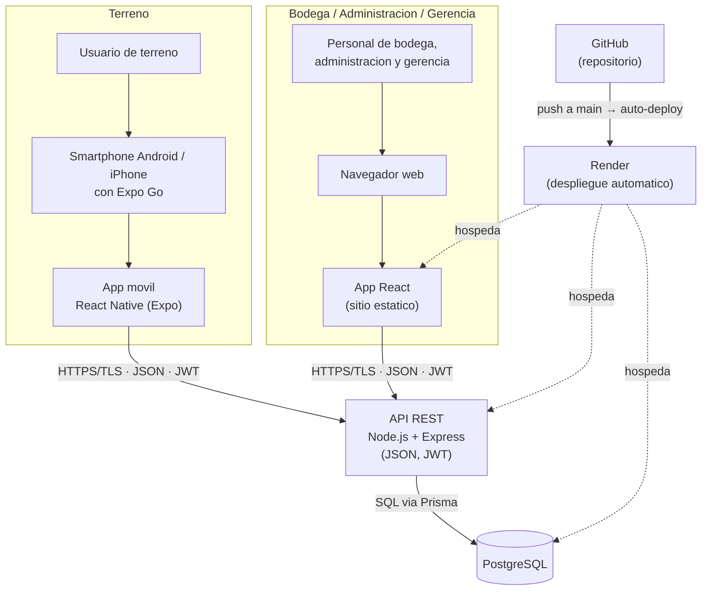

# 2.1.1.1 — Diagrama de topología

Estructura y patrón de comunicaciones entre los componentes del prototipo BosqueSur ES3.

> Código fuente del diagrama: [`diagramas/topologia.mmd`](diagramas/topologia.mmd).
> GitHub renderiza automáticamente el bloque Mermaid siguiente.

## Explicación

### Patrón cliente-servidor
El sistema sigue un patrón **cliente-servidor**. Existen dos clientes —la aplicación web (React)
usada por bodega, administración y gerencia, y la aplicación móvil (React Native/Expo) usada por
terreno— que consumen un **único servidor**: la API REST (Node.js + Express). El servidor concentra
toda la lógica de negocio y es el único que accede a la base de datos.

### Comunicación sin estado mediante JWT
La comunicación es **sin estado (stateless)**: el servidor no guarda sesiones en memoria. Tras el
login, la API emite un **JSON Web Token (JWT)** firmado y con expiración; cada petición posterior lo
envía en el encabezado `Authorization: Bearer <token>`. El backend valida la firma y el rol en cada
request. Esto permite escalar horizontalmente y que web y móvil usen exactamente el mismo mecanismo.

### Protocolos utilizados
- **HTTPS/TLS** entre los clientes y la API (en el despliegue de Render, con certificados gestionados).
- **JSON** como formato de intercambio en todas las peticiones y respuestas.
- **SQL** entre la API y PostgreSQL, generado por el ORM **Prisma**.
- **HTTPS (git)** para el flujo GitHub → Render.

### Puertos locales y servicios desplegados
| Componente | Local (puerto) | Desplegado (Render) |
|---|---|---|
| API | `4000` (`/api`) | `https://bosquesur-api.onrender.com/api` |
| Web | `5173` (Vite dev) / `4173` (preview) | `https://bosquesur-web.onrender.com` |
| Expo (Metro) | `8081` | app abierta en Expo Go |
| PostgreSQL | `5432` | servicio administrado interno de Render |

### Por qué web y móvil usan el mismo backend
Ambos clientes apuntan a la **misma API REST** y, por lo tanto, a la **misma base de datos**. El
beneficio para BosqueSur es directo: lo que el personal de terreno registra en el móvil (predios,
cosechas) queda disponible de inmediato para bodega y oficina, sin reingreso manual ni archivos
intermedios. Esto resuelve el problema central del caso: evitar registros paralelos e inconsistentes
entre terreno, bodega y oficina.

### Cómo se evita mantener información paralela
El **inventario es la fuente única de información**: no se mantienen saldos calculados a mano ni
copias en planillas. El stock de cada especie solo se modifica dentro de una **transacción** del
backend que, al confirmar una recepción, crea la recepción, actualiza el inventario con un
**incremento atómico**, registra el movimiento (saldo anterior/posterior), cambia el estado del
despacho y escribe auditoría. Si algo falla, **toda** la operación se revierte. Así nunca coexisten
dos "verdades" distintas del inventario.
