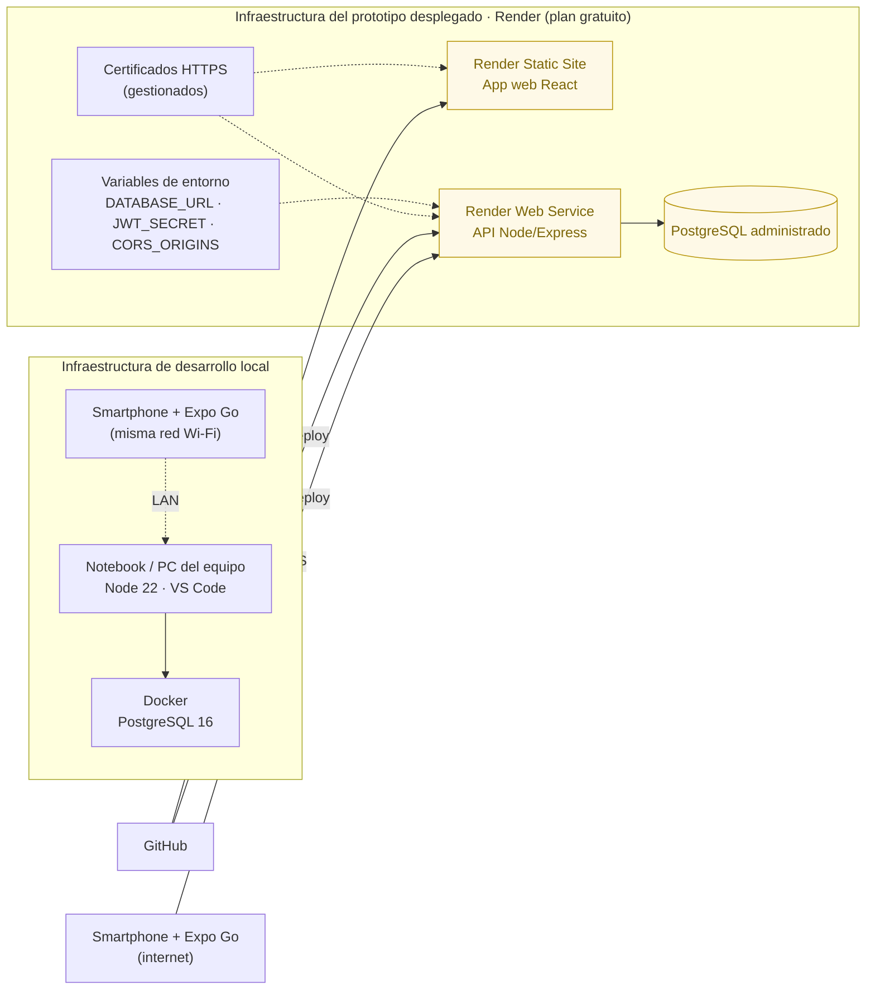

# 2.1.1.2 — Diagrama de infraestructura

Recursos físicos y tecnológicos necesarios para implementar el prototipo, distinguiendo el ambiente
de **desarrollo local** del **prototipo desplegado**.

> Código fuente del diagrama: [`diagramas/infraestructura.mmd`](diagramas/infraestructura.mmd).

## Componentes

### Dispositivos físicos
- **Computadores / notebooks** del personal de bodega, administración y gerencia (navegador web).
- **Smartphones** del personal de terreno (Android o iPhone) con la app **Expo Go**.
- **Conexión a internet** en ambos extremos.

### Componentes de software
- App web React (estática), app móvil React Native/Expo, API Node/Express, Prisma ORM.

### Servicios gestionados (Render, plan gratuito)
- **Render Static Site** → sirve la app web compilada (`apps/web/dist`).
- **Render Web Service** → ejecuta la API Node/Express.
- **PostgreSQL administrado** → base de datos gestionada por Render.
- **Certificados HTTPS** y **variables de entorno** gestionados por la plataforma.

### Flujo de despliegue
`GitHub (push a main)` → Render detecta el cambio (Blueprint `render.yaml`) → **reconstruye y
despliega** automáticamente la web y la API. La API, al iniciar, ejecuta migraciones y seed.

## Distinción de ambientes

| Aspecto | Desarrollo local | Prototipo desplegado |
|---|---|---|
| Base de datos | PostgreSQL 16 en **Docker** (`docker-compose.yml`) | PostgreSQL administrado (Render) |
| API | `node src/server.js` en `localhost:4000` | Render Web Service (HTTPS) |
| Web | Vite dev `5173` / preview `4173` | Render Static Site (HTTPS) |
| Móvil | Expo Go por LAN (misma Wi-Fi) o `--tunnel` | Expo Go por internet contra la API de Render |
| Secretos | archivos `.env` locales (no versionados) | variables de entorno de Render |

## Restricciones del plan gratuito (importantes para la evaluación)
- **Cold start:** los servicios gratuitos se **suspenden tras ~15 min** de inactividad; la primera
  petición puede tardar **~50 s** en responder mientras el servicio "despierta". No refleja el
  rendimiento normal (ver `07_SEGURIDAD_RENDIMIENTO.md`, donde se registra por separado).
- **Base de datos gratuita:** puede tener **límites de tamaño/tiempo y expirar** tras un periodo
  (Render lo notifica). Riesgo para la demostración si se deja para el último día. Mitigación: el
  Blueprint permite recrear la infraestructura y la API re-siembra los datos al iniciar.
- **Recursos limitados** (CPU/RAM) del plan gratuito: adecuado para un prototipo académico, no para
  carga productiva.
