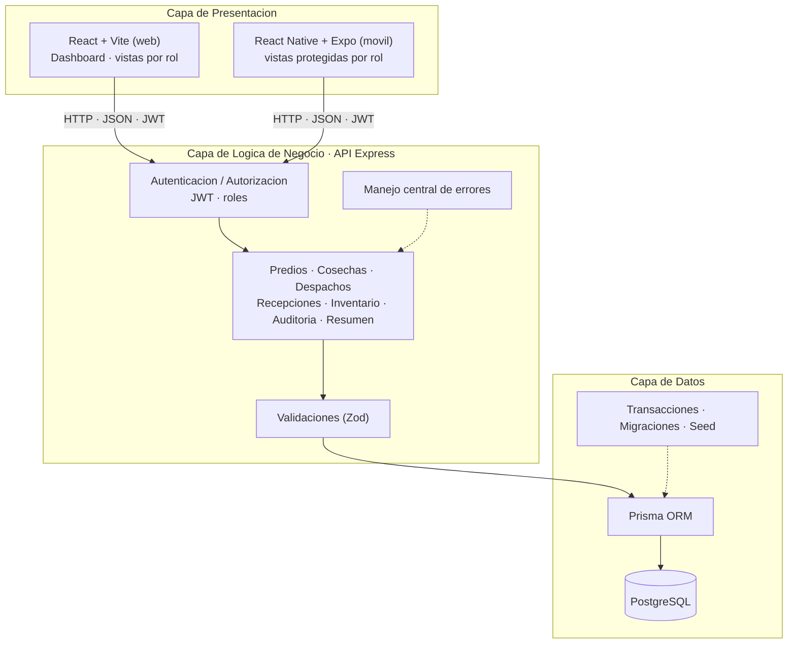
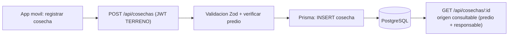
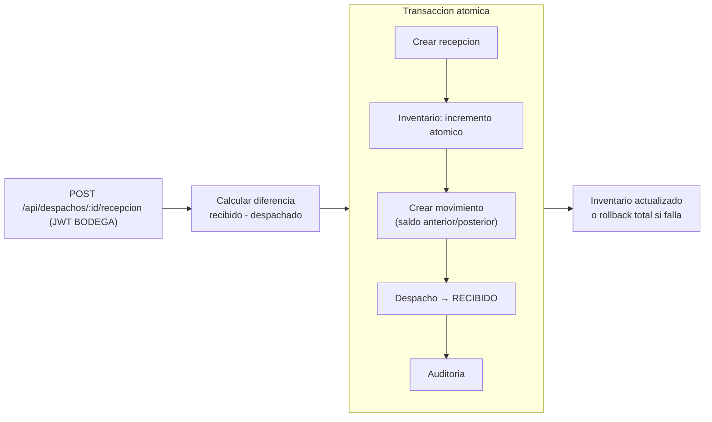

# 2.1.1.3 — Diagrama de arquitectura

Estructura, lógica y funcionalidad del sistema desde una perspectiva de alto nivel, organizada en
**tres capas**.

> Código fuente del diagrama: [`diagramas/arquitectura.mmd`](diagramas/arquitectura.mmd).

## Capa de Presentación
- **React + Vite (web):** pantalla de login, dashboard con indicadores, despachos, recepción,
  inventario, movimientos, recepciones, resumen y auditoría. Navegación **protegida por rol**
  (`components/ProtectedRoute.jsx`, `components/Layout.jsx`).
- **React Native + Expo (móvil):** login, predios, cosechas y detalle de origen; vistas acordes al
  rol TERRENO.

## Capa de Lógica de Negocio (API Express)
Organizada por módulos con responsabilidades separadas (`apps/api/src/modules/*`), cada uno con
rutas, controlador, servicio y validadores:
- **Autenticación / Autorización:** `middlewares/authenticate.js`, `middlewares/authorize.js`.
- **Dominios:** predios, cosechas, despachos, recepciones, inventario, auditoría, resumen.
- **Validaciones:** `middlewares/validate.js` + `*.validators.js` (Zod).
- **Manejo centralizado de errores:** `middlewares/error.js` (respuestas JSON controladas, sin trazas).

## Capa de Datos
- **Prisma ORM** (`apps/api/prisma/schema.prisma`) sobre **PostgreSQL**.
- **Transacciones** para la recepción (atómica), **migraciones** versionadas y **seed** idempotente.

## Flujos principales

### Registro móvil de cosecha

### Recepción de despacho con diferencia

Esta arquitectura de tres capas mantiene la **separación de responsabilidades**, permite que web y
móvil reutilicen la lógica del backend y garantiza que el inventario sea consistente mediante
transacciones.
